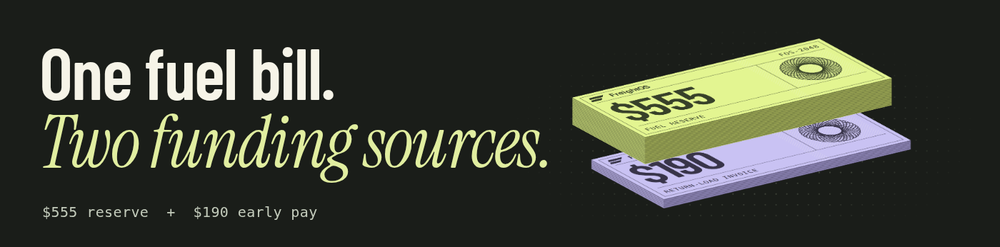
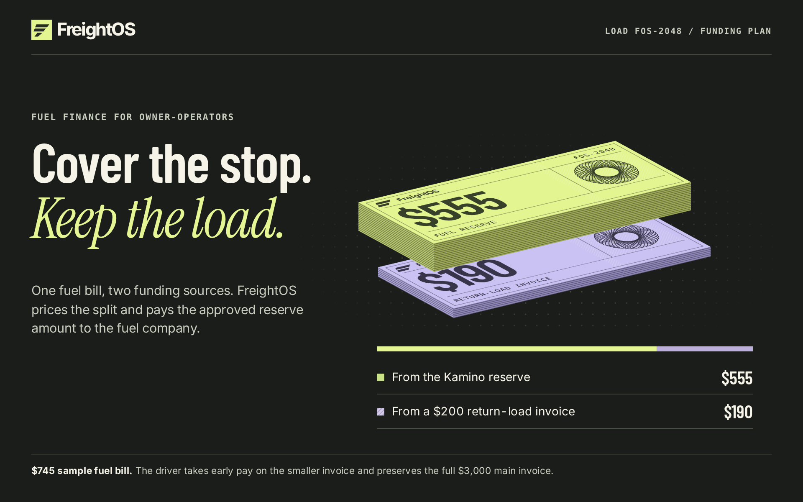
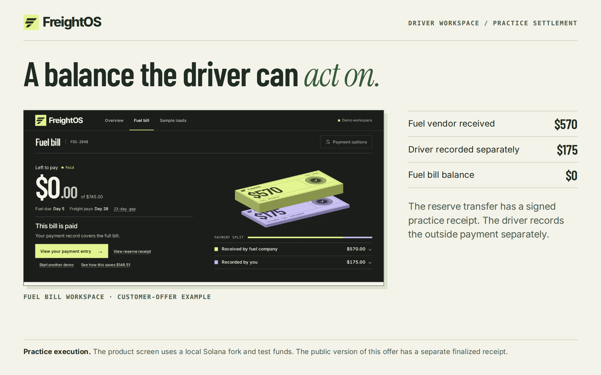
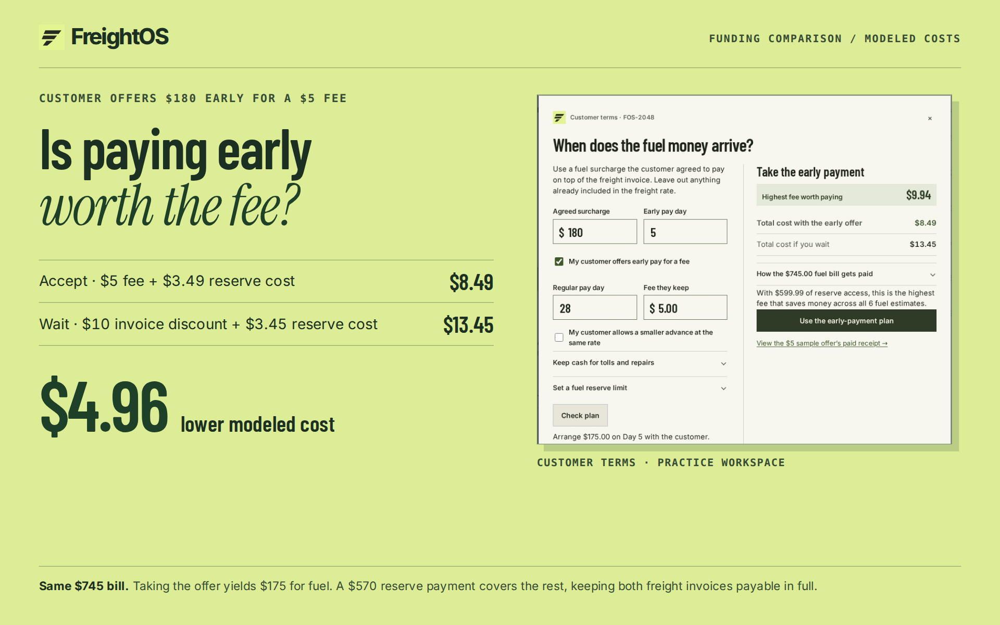
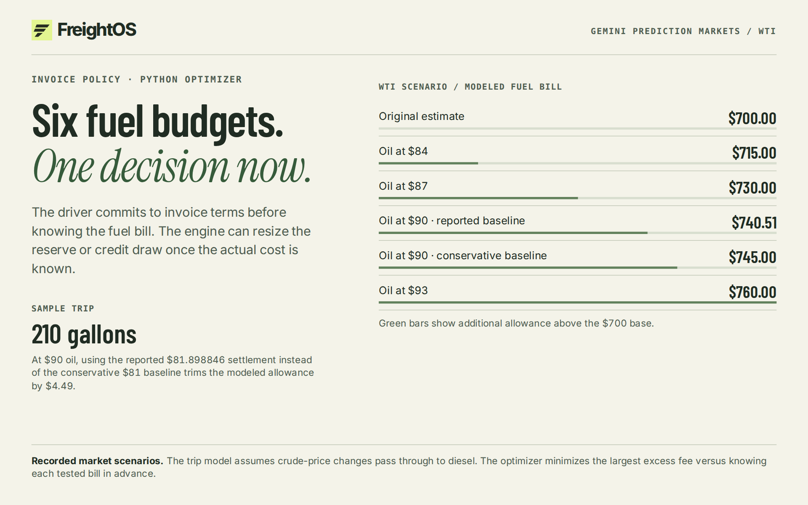
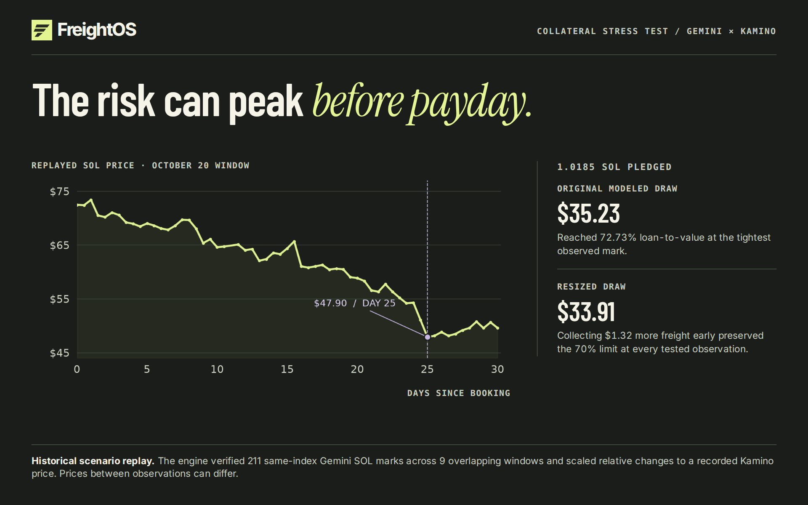
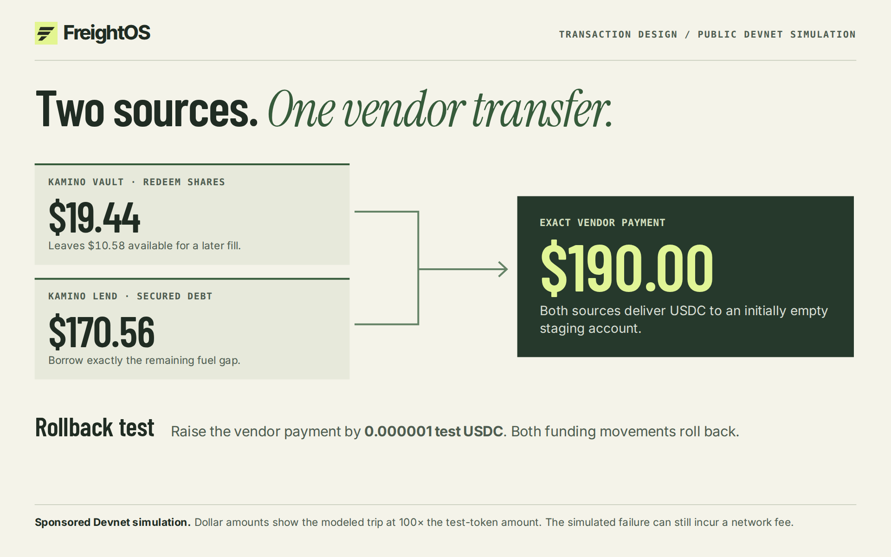
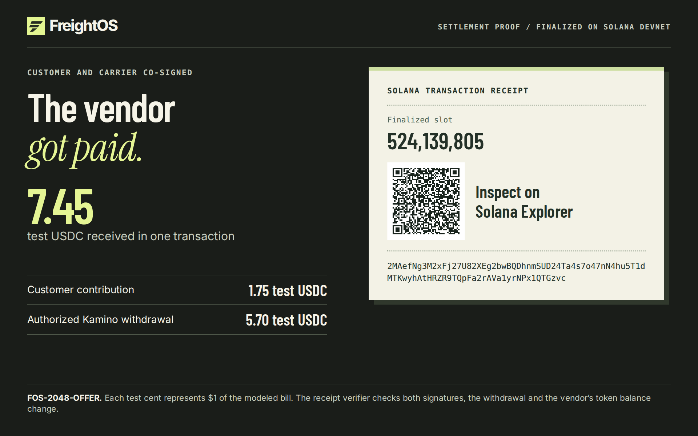
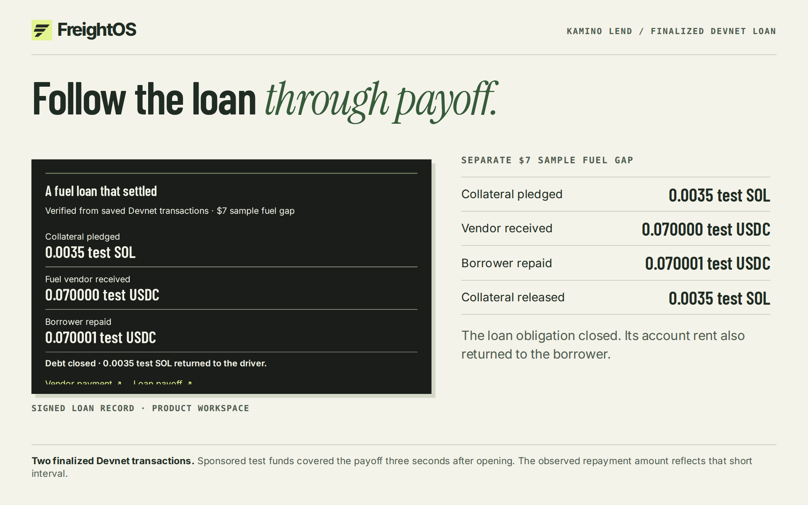
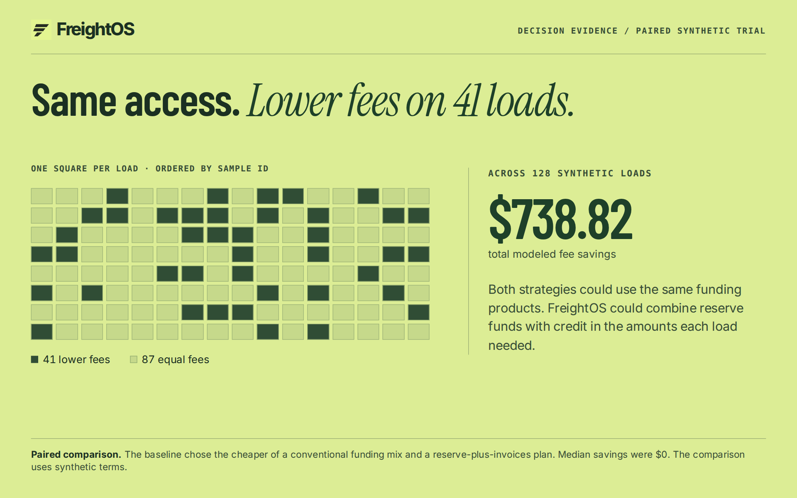

# FreightOS

FreightOS is our project for the University Blockchain Conference (2026) at UT Austin.

[View the video demo here](https://drive.google.com/file/d/16KvcYP4_vLwlDHxuuC0WfDixWqsCn9zr/view?usp=sharing).

FreightOS helps an owner-operator decide how to pay a fuel bill while keeping enough cash for the next trip. The Python engine prices freight invoice terms alongside Kamino vault withdrawals, SOL-backed credit, and eligible Orca swaps. The driver sees the payee, amount, fees, and remaining balance. A Rust program on Solana enforces the approved reserve payment.

## Project gallery

[](docs/media/01-cover-the-stop.png)

<details>
<summary><strong>Explore all 9 images</strong> · Product screens, funding decisions, and onchain receipts</summary>

<h3>The driver’s bill</h3>

<p>
  <a href="docs/media/01-cover-the-stop.png"></a>
  <a href="docs/media/02-the-driver-statement.png"></a>
  <a href="docs/media/04-price-the-customer-offer.png"></a>
</p>

<h3>Inside the funding engine</h3>

<p>
  <a href="docs/media/03-gemini-fuel-budgets.png"></a>
  <a href="docs/media/05-collateral-before-payday.png"></a>
  <a href="docs/media/06-one-atomic-payment.png"></a>
</p>

<h3>Receipts and results</h3>

<p>
  <a href="docs/media/07-finalized-vendor-receipt.png"></a>
  <a href="docs/media/08-close-the-fuel-loan.png"></a>
  <a href="docs/media/09-the-same-access-test.png"></a>
</p>

</details>

## Run the project

From a fresh checkout, use Python 3.11 or later and [uv](https://docs.astral.sh/uv/).

```bash
git clone https://github.com/evanwohl/Blockchain-Hackathon-2026.git
cd Blockchain-Hackathon-2026
uv sync --locked
uv run --locked python -m freightos.app
```

Open **http://127.0.0.1:8783**. The practice workspace runs against bundled data and program binaries after installation. It starts with a fresh in-memory wallet shared by tabs. Restart the server to reset it, or pass `--port 8784` to launch a separate session. On a phone, create a Codespace and open **Ports → FreightOS demo (8783) → Open in Browser**. [Launch a private Codespace](https://codespaces.new/evanwohl/Blockchain-Hackathon-2026)

| Open in the running app | What to follow |
| --- | --- |
| [Overview and fuel bill](http://127.0.0.1:8783/) | Choose **Walk through this bill**, review the funding sources, then approve the reserve leg. The outside payment has its own driver-reported entry. |
| [Finalized customer offer](http://127.0.0.1:8783/public-offer) | Check the customer contribution and vault redemption against one public Devnet payment. |
| [Settled fuel loan](http://127.0.0.1:8783/load#credit) | Follow a separate Kamino loan through collateral deposit, vendor payment, repayment, and collateral release. |
| [Combined funding simulation](http://127.0.0.1:8783/fuel-credit#one-payment) | Inspect a vault withdrawal and a secured loan paying one vendor, including a failed-payment rollback. |
| [Sample loads](http://127.0.0.1:8783/trial) | Inspect the funding choices and fee baselines for 128 synthetic loads. |

## From market evidence to a funding decision

**Gemini supplies two distinct risk inputs.** For fuel, FreightOS reads a recorded ladder of WTI prediction-market contracts with a common expiry. It checks the settlement index, timestamps, reported outcomes, and evidence hash. The trip model turns an oil-price change into a fuel allowance using gallons and an explicit crude-to-diesel pass-through assumption. On the 210-gallon sample trip, testing $90 oil against a conservative $81 baseline raises the $700 fuel budget to $745. Using the reported $81.898846 settlement instead gives $740.51. Both budgets are available for inspection. The resulting dollar amounts are fuel-budget scenarios. [Fuel-budget construction](freightos/funding.py)

The protection planner also uses the Gemini bid/ask ladder to price hypothetical oil protection against borrowing. A higher oil threshold can only pay in a subset of the outcomes where a lower threshold pays. The engine therefore bounds portfolio value over threshold prices that decrease or stay level as the strikes rise, while remaining inside the verified bid/ask spreads. It counts a payout toward the fuel bill only if the driver can spend it by the deadline. In the saved Midwest example, $5.55 is the smallest modeled all-in premium that covers the target with a timely payout. If settlement arrives too late, the $24.30 cash gap remains. This comparison uses recorded order books and submits no Gemini orders.

**The invoice decision must work before the fuel price is known.** A driver can accept an early-payment offer today and size a reserve draw later. The optimizer therefore fixes one set of invoice choices across six fuel budgets and solves a dated cash-flow problem for each. A candidate must cover bills, fees, and repayments while respecting the cash floor. In the default invoice policy, a scenario’s *regret* is the extra fee relative to the cheapest plan that could have been chosen with that bill known in advance. FreightOS chooses the feasible invoice terms with the smallest worst-case regret. This prevents a backtest from choosing a different contract in each scenario after seeing the outcome. [Cash-flow solver](hedging/quick_pay.py) · [Invoice policy](hedging/invoice_policy.py)

**Collateral can get tight before the customer pays.** For SOL-backed borrowing, the engine reconstructed nine overlapping 30-day windows from 211 verified same-index Gemini settlement marks. It applies the observed relative price changes to the recorded Kamino price, accrues debt at twice the recorded borrowing rate in the stress case, and checks loan-to-value at each available observation. In the October 20 window, a $35.23 loan against 1.0185 SOL reached 72.73% on day 25. Reducing the draw to $33.91 and collecting another $1.32 of freight early kept the loan within the driver’s 70% limit at every tested mark. Gaps between observations remain a source of risk. The funding desk also prices selling SOL through Orca and the cost of restoring the position on payday. [Collateral replay](freightos/collateral_path.py) · [Loan sizing](freightos/mainnet_loan.py) · [Cash and swap comparison](freightos/road_cash.py)

## What Solana enforces

A vault balance alone does not establish how much a driver can send. Shares are indivisible at their smallest unit, and deposit and redemption can each introduce rounding. FreightOS simulates both operations before quoting the required deposit. When the driver authorizes payment, the Rust program stores the payer, vendor token account, staging account, exact USDC amount, maximum share burn, and commitment to the funding decision. At settlement it reads the transaction’s instruction sysvar and checks the staging-account initialization, withdrawal from the designated Kamino vault, and exact SPL Token transfer to the approved vendor. Only then does it mark the bill settled. A mismatch rolls back the token movements. A settled authorization cannot pay the same bill twice. [Rust settlement guard](settlement_program/src/lib.rs) · [Instruction construction](freightos/reserve.py)

**Finalized payment.** For the $745 customer-offer example, the driver compares taking a $180 surcharge early for a $5 fee with waiting. Taking the offer releases $175, leaves $570 for the reserve, and costs $8.49 in total modeled fees versus $13.45 for waiting. The customer and carrier then co-signed the public Devnet version. In one transaction the customer contributed 1.75 test USDC, Kamino supplied 5.70, and the vendor received exactly 7.45. One test cent represents one modeled dollar. The verifier reconstructs the decision, checks the signers and instruction messages, and reconciles the token and vault-share balance changes. [Finalized transaction on Solana Explorer](https://explorer.solana.com/tx/2MAefNg3M2xFj27U82XEg2bwBQDhnmSUD24Ta4s7o47nN4hu5T1dMTKwyhAtHRZR9TQpFa2rAVa1yrNPx1QTGzvc?cluster=devnet) · [Receipt verifier](freightos/public_offer.py)

**Atomic funding simulation.** On a separate $190 stop, the plan keeps $10.58 of reserve capacity for a later fill, redeems $19.44 from the vault, and borrows $170.56 from Kamino Lend. In the scaled public Devnet simulation, both sources fund one previously empty token account. The transaction sends the fixed amount to the vendor, returns any quoted change, and closes the staging account. Raising the payment by one raw USDC unit triggers a failure. The verifier checks that balances rolled back apart from the attempted network fee. The separate $7 loan on the settled-loan screen has finalized opening and repayment signatures. [Combined route and rollback verifier](freightos/atomic_fuel.py) · [Settled loan verifier](freightos/load_credit.py)

## How we evaluated the engine

The same-access comparison gives both strategies the same synthetic offers and deadlines. The baseline chooses the cheaper of a conventional funding mix and a reserve-plus-invoices plan. FreightOS can also combine the reserve with credit. Across 128 loads, that flexibility lowered modeled fees on **41**, tied on **87**, and saved **$738.82** in total. Median savings were **$0**. Fifty selected reserve payments also executed and replayed on the bundled Solana fork. The trial measures funding costs under generated commercial terms. The signed receipts establish the amounts transferred in the test environments. [Trial data and per-load receipts](freightos/artifacts/quick_pay/carrier_trial.json)

## Verify the evidence and run tests

From the repository root, replay the packaged customer offer, finalized loan, and combined funding simulation. These commands read saved evidence and require no wallet.

```bash
uv run --locked python -m freightos.public_offer
uv run --locked python -m freightos.load_credit
uv run --locked python -m freightos.atomic_fuel
```

Add `--live` to the first two commands to fetch finalized transactions from the public Devnet RPC. On `atomic_fuel`, `--live` requests a fresh unsigned simulation. For a receipt downloaded from the practice workspace, pass its file path to `freightos.verify_receipt`. The practice fork loads captured Kamino programs and accounts from mainnet slot 471210845 into LiteSVM. The separate `freightos.live` CLI prepares unsigned mainnet transactions for an eligible wallet.

```bash
uv run --locked python -m freightos.verify_receipt path/to/receipt.json
uv sync --locked --extra dev
uv run --locked --extra dev pytest -q
```

The browser loads the bundled Rust program. To rebuild the fork binary, set `SOLANA_PLATFORM_TOOLS` to the extracted Anza v1.58 platform-tools directory and run `bash settlement_program/build.sh`. Browser assets live in `freightos/web/`, HTTP routes in `freightos/app.py`, and the packaged evidence in `freightos/artifacts/`. [Build script](settlement_program/build.sh) · [Contributor and demo guide](AGENTS.md)
